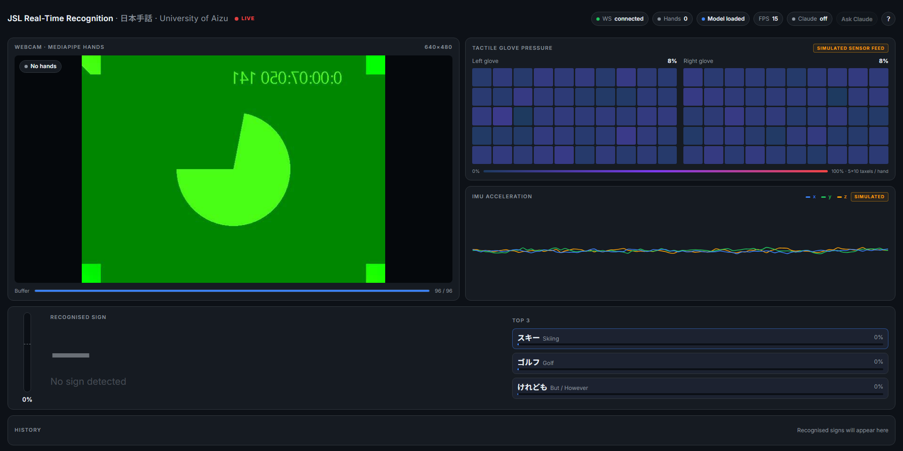
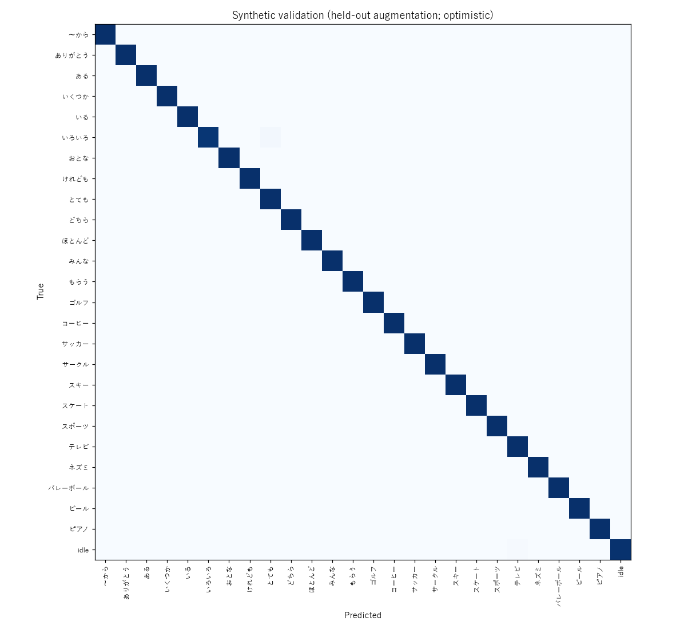

# JSL Real-Time Recognition

Real-time Japanese Sign Language (日本手話) recognition demo for a Master's thesis at the
University of Aizu. A webcam feed goes through MediaPipe Hands, then a small Transformer
classifies the last ~3.2 s of hand motion into one of 25 signs (or "no sign").



> **Honesty notes.** The classifier uses the **webcam only**. The glove heat maps and IMU trace
> in the UI are a **simulated sensor feed** (badged as such) that stands in for the lab's tactile
> gloves. Training data is **one reference video per sign** from a single signer, so the
> validation accuracy below is optimistic. The real test is live use by other people.

## Quick start (Windows 11, Python 3.11)

MediaPipe 0.10.9 has no wheels for Python 3.12+, so use **Python 3.10 or 3.11**.

```powershell
py -3.11 -m venv .venv
.venv\Scripts\activate
pip install -r requirements.txt
```

Put the video zip (`jsl 25 words.zip`) or the 25 `.mp4` files in `data/raw/`, then:

```powershell
python scripts/extract_landmarks.py   # videos -> data/landmarks_full/*.npy   (~1 min)
python run_training.py                # -> models/jsl_model.onnx, meta.json, confusion.png  (~5-10 min CPU)
python run_server.py                  # open http://127.0.0.1:8000
```

`models/jsl_model.onnx` is committed, so `python run_server.py` works right after
`pip install` with no videos or training. If the ONNX file is missing, the server starts in
**DEMO mode** and cycles through signs so the UI can still be shown.

### OpenCV webcam app (no browser)

```powershell
python scripts/webcam_demo.py              # OpenCV window: q / Esc quits, c asks Claude
python scripts/webcam_demo.py --camera 1   # pick another camera
```

On Windows the app opens the camera through Media Foundation (MSMF). On a typical webcam,
DirectShow delivers only about 8 fps, MSMF about 24.

### Optional: Claude as a second opinion

The OpenCV, MediaPipe and Transformer pipeline is always the real-time classifier. If you add a
Claude API key, each recognised sign is also double-checked by Claude (vision). Claude receives
6 keyframes of your clip plus labelled keyframe sheets of the 25 reference videos, and picks the
matching sign from the closed list (or "none"). The UI shows **CLAUDE AGREES / CLAUDE DIFFERS**
under the prediction, and the **Ask Claude** button checks the current clip on demand.

```powershell
copy .env.example .env                         # then paste your key after ANTHROPIC_API_KEY=
python scripts/build_reference_sheets.py       # once; needs the videos in data/raw/
python run_server.py
```

- Uses `claude-opus-5-5` at low effort with structured JSON output. Server-side refusal fallback
  is on. The 25 reference sheets are prompt-cached, so repeat calls cost little and run faster.
  Expect a few seconds per check. It runs in the background and never blocks the live view.
- **Privacy:** when a key is configured, 6 keyframes of the webcam clip are sent to the Anthropic
  API for each check. Without a key, nothing leaves the machine.
- `.env` and `data/reference_sheets/` (which contain the reference signer's image) are git-ignored.

Verification scripts:

```powershell
python -m pytest tests                # unit tests
python scripts/replay_test.py         # replays the 25 reference videos through the live predictor
python scripts/replay_test.py --fps 10   # same, simulating a 10 fps camera
python scripts/ui_check.py            # server + WebSocket + headless Chromium screenshots
                                      # (first run: python -m playwright install chromium)
```

## Results

Measured on a Windows 11 laptop CPU (2026-10-13).

| Check | Result |
|---|---|
| Landmark extraction | **25/25 signs**. Hands detected in 88–100% of signing frames: 23 signs at ≥97%, ほとんど 97%, ゴルフ 88% (the hands overlap). See `data/extraction_report.json` |
| Training | Early-stopped at epoch 51 in about 8 min on CPU |
| Validation (held-out seeds/speeds, **optimistic**) | top-1 **99.9%**, top-3 **100%**, per-class F1 ≥ 0.99 (`models/train_report.json`, `models/confusion.png`) |
| ONNX parity | max \|torch − onnx\| = 2.9e-6 (< 1e-4) ✔ |
| **Replay test** (25 reference videos through the live predictor, frame by frame) | **25/25** correct, with **0** wrong or duplicate emissions (`models/replay_report.json`) |
| Idle behaviour | An empty or black camera never emits a sign (pytest + UI check) |
| Replay at a simulated 15 fps and 10 fps camera | **25/25** and **25/25**. The earlier frame-count buffer scored 11/25 at 10 fps |
| Unit tests | 25 passed |
| Real webcam (camera 0, 640×480) | Opens and runs end to end at 23–24 fps on MSMF (processing alone: about 42 fps) |
| UI check (headless Chromium, fake camera, 1920×960 and 1280×720) | No console errors, no page overflow, WebSocket connected, about 15–16 processed frames/s |

What the replay test measures: each video is replayed as if live, with 1 s of rest before it,
then the signing, then 1.5 s of rest after, all through MediaPipe, the 96-frame buffer, EMA
smoothing and the decision logic. It shows that the training and live pipelines are
consistent. It does **not** show generalisation to new signers, because these are the training
recordings.

**Fix found by the replay test:** the first model scored 22/25, but 4 signs had a wrong sign
emitted first. The wrong emission always came 30–40 frames into the sign, when only the opening of
the sign was in the buffer. Training had never seen a half-finished sign, so the model guessed
with confidence. Adding partial-sign windows (opening ≤ 50% or tail ≤ 30% of a sign) as *idle*
fixed this without loosening any threshold. Result: 25/25 with no spurious emissions.



## Architecture

```
 Browser (frontend/index.html)                     Python server (FastAPI, run_server.py)
 ┌───────────────────────────────┐   WS /ws        ┌───────────────────────────────────────────────┐
 │ getUserMedia 640x480          │ ─────────────►  │ decode JPEG (latest frame only, drop stale)   │
 │ canvas -> JPEG (<=18 fps,     │ {"type":"frame",│        │                                      │
 │  waits for previous reply)    │  "data":b64}    │        ▼                                      │
 │                               │                 │ MediaPipe Hands (2 hands, conf 0.5)           │
 │ annotated frame (CSS mirror)  │                 │        │  src/common/features.py (shared with │
 │ prediction / top-3 / history  │ ◄─────────────  │        ▼  extraction): 126-d, L|R slots,      │
 │ glove heat maps + IMU chart   │   payload JSON  │   wrist-relative, missing hand = 0            │
 │  [SIMULATED SENSOR FEED]      │                 │ timestamped buffer: last 3.2 s interpolated   │
 └───────────────────────────────┘                 │ at 60 instants (any camera fps), every 0.1 s  │
                                                   │        ▼                                      │
                                                   │ ONNX Transformer ─► softmax ─► EMA(α=0.4)     │
                                                   │        ▼                                      │
                                                   │ decision: not idle, conf>=0.60, 5 stable      │
                                                   │ predictions, 1.5 s cooldown, re-arm on change │
                                                   │ on emit / "Ask Claude": 6 keyframes + 25      │
                                                   │ cached reference sheets ─► Claude (optional)  │
                                                   │ SimulatedGlove (GloveSource) ─► UI only       │
                                                   └───────────────────────────────────────────────┘
```

Model: Linear(126→128) → [CLS] + sinusoidal positions (61) → 2 × Pre-LN Transformer encoder
layers (4 heads, FFN 256, GELU, dropout 0.2) → LayerNorm → Linear(128→26). The 26th class is
**idle** ("—"), so the system stays quiet when nobody is signing.

### Train/inference temporal consistency

The live system classifies the last 3.2 s of hand motion, sampled at 60 evenly spaced instants.
The buffer is **time-based**: frames carry timestamps and are interpolated onto the 30 fps
timeline used in training, so a 10, 15 or 30 fps camera all produce the same input. (A plain
"last 96 frames" buffer would cover 9.6 s at 10 fps and make every sign look three times faster.)
Training builds samples the same way rather than squashing each whole video to 60 frames:

1. Take the sign's full 30 fps sequence (rest → sign → rest) and speed-warp it (×0.7–1.4).
2. Slide a 96-frame window over it so that at least 80% of the active sign ("core", found
   automatically from distance to the rest pose) is inside. Positions outside the recording are
   filled with zeros (hands out of view) or a held rest pose. 30% of the time the surrounding rest
   frames are also zeroed.
3. Augment: mirror (swap hands and negate x), scale 0.85–1.15, rotation ±10°, per-hand frame
   dropout, Gaussian noise σ=0.005 on visible hands.
4. Resample 96 → 60 frames with the same function the live predictor uses.

Idle samples cover an empty buffer, the signer's resting pose (stretched), hands entering or
leaving the view, and **partial signs**: the first ≤50% of a sign at the newest end of the buffer,
or the last ≤30% at the oldest end. This makes the model wait until a sign is mostly visible.
Each epoch draws 96 new samples per sign plus 288 idle samples.

**Validation** uses a held-out RNG seed and speed bands (0.85–0.90, 1.20–1.25) that training
never samples. It is still the same 25 recordings, so **val accuracy is optimistic**.

## Repository layout

```
data/label_map.json, signs_english.json   class ids -> Japanese -> English
data/raw/                                 videos go here (git-ignored)
scripts/extract_landmarks.py              videos -> landmark .npy files + extraction_report.json
scripts/replay_test.py                    live-path replay of the 25 reference videos
scripts/ui_check.py                       end-to-end server/UI check with screenshots
scripts/webcam_demo.py                    standalone OpenCV webcam app
scripts/build_reference_sheets.py         reference keyframe sheets for the Claude second opinion
src/common/                               config + shared feature extraction
src/train/                                dataset/augmentation, model, training loop, ONNX export
src/inference/                            predictor, Claude verifier, simulated glove, FastAPI server
frontend/index.html                       single-file UI (no build step)
models/                                   jsl_model.onnx, meta.json, reports, confusion.png
hardware/glove_design/                    tactile glove embroidery files (.pes)
tests/                                    pytest suite
```

## Known limitations

- **One signer, one example per sign.** The model has only seen one person's hands, body
  proportions and signing speed. Expect lower accuracy for other people, other camera angles and
  lighting. Validation numbers are optimistic. Judge the system by live testing.
- **Handedness.** MediaPipe's left/right labels on unmirrored frames are what the model was
  trained on. Mirror augmentation helps left-handed signers, but signs that differ only by
  handedness may be confused.
- **Overlapping hands.** Signs where the hands touch or overlap (e.g. ゴルフ) lose detections.
  Extraction reaches 88% frame coverage for ゴルフ; live detection at confidence 0.5 is lower.
- **Isolated signs only.** The buffer holds one sign. Rest briefly (lower your hands) between
  signs. Continuous sentence recognition is out of scope.
- **Simulated glove panel.** The heat maps and IMU trace come from `SimulatedGlove`. They react
  loosely to hand openness and motion so the demo looks plausible, but they are **not real sensor
  data** and the classifier never uses them.

## Plugging in a real glove

Implement `GloveSource` in `src/inference/glove_sim.py`:

```python
from src.inference.glove_sim import GloveSource

class SerialGlove(GloveSource):
    def read(self, landmarks=None) -> dict:
        # 50 pressure values in 0..1 per hand (5 x 10 grid, row-major) and 6 IMU values
        return {"left":  {"pressure": [...50 floats], "imu": [ax, ay, az, gx, gy, gz]},
                "right": {"pressure": [...], "imu": [...]},
                "simulated": False}
```

Pass it to the predictor (`JSLPredictor(glove=SerialGlove())` in `src/inference/server.py`),
and remove the "SIMULATED" badges in `frontend/index.html`. To use glove data for
classification you would also need to add it to the feature vector and retrain.

## Adding more signs

1. Add the videos (file name = Japanese sign name, e.g. `こんにちは.mp4`) to `data/raw/`.
2. Add entries to `data/label_map.json` (`"25": "こんにちは"`) and `data/signs_english.json`.
3. Update `NUM_SIGNS` in `src/common/config.py`. The idle class is always the last index.
4. `python scripts/extract_landmarks.py`, then `python run_training.py`.

More recordings per sign, ideally from different signers, will improve real-world accuracy far
more than further model changes.
