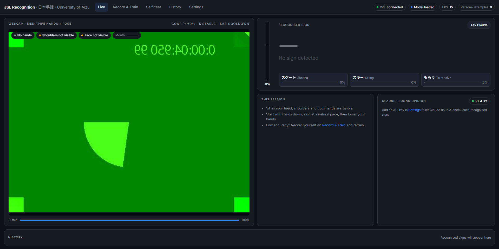

# JSL Real-Time Recognition

Real-time Japanese Sign Language (日本手話) recognition for a Master's thesis at the University of
Aizu. A webcam feed goes through **OpenCV → MediaPipe Hands + Pose + Face Mesh → a Conv1D +
Transformer network** (architecture of the 1st-place Kaggle sign-language solution). It sees hand
shapes, arm and hand positions relative to the body, **lip/mouth movement (mouthing)**, eyes,
eyebrows and head tilt, and classifies the last ~3.2 s of motion into one of 25 signs (or "no sign"). A dashboard lets you
record your own examples, retrain, measure your real accuracy and, optionally, ask **Claude** for a
second opinion.



> **Honesty notes.** Recognition uses the **webcam only** (no glove/IMU is connected; the optional
> glove panel is a labelled simulation). The base model is trained on **one reference video per
> sign from one signer**. For good accuracy on *your* signing, record yourself on the
> Record & Train page and retrain. Then measure it on the Self-test page.

## Quick start (Windows 11, Python 3.11)

MediaPipe 0.10.9 has no wheels for Python 3.12+, so use **Python 3.10 or 3.11**.

```powershell
py -3.11 -m venv .venv
.venv\Scripts\activate
pip install -r requirements.txt
python run_server.py                  # open http://127.0.0.1:8000 in Chrome or Edge
```

`models/jsl_model.onnx` is committed, so the server works immediately. To rebuild everything from
the videos, put `jsl 25 words.zip` (or the 25 `.mp4` files) in `data/raw/`, then run:

```powershell
python scripts/extract_landmarks.py --zooms 1.3,1.6,2.1   # features + simulated close-webcam crops (~15 min)
python scripts/build_reference_sheets.py                  # reference keyframes (Record page + Claude)
python run_training.py                                    # ~10 min on a GTX 1060 (or use the dashboard)
```

Training uses an NVIDIA GPU automatically if PyTorch has CUDA (`pip install torch==2.14.1 --index-url
https://download.pytorch.org/whl/cu126` - supports GTX 10-series and newer); otherwise the CPU.

## Dashboard

| Page | What it does |
|---|---|
| **Live** | Real-time recognition: big sign display, confidence and top-3, hand / shoulder / face status, mouth-movement meter, personal-examples count, session log, Claude verdict (AGREES / DIFFERS), history tape |
| **Record & Train** | Guided recording of your own takes (countdown, quality check, reference keyframes, progress for all 25 signs). Every saved take is **immediately** used as a personal example (no retraining needed); one-click **retrain** (GPU) with live progress chart and **roll back** |
| **Self-test** | Shows a random sign, you perform it, and it records whether it was recognised. Gives real accuracy per sign, what each sign is confused with, past runs, CSV export |
| **History** | Every recognised sign with confidence and Claude's verdict and reason; search, stats, CSV export |
| **Settings** | Claude API key and model, when to ask Claude, connection test; camera picker; recognition thresholds; recording, test and display options; dark or light theme |

### Recommended workflow

1. **Settings:** pick your camera. Sit centred so your **whole head, shoulders and both hands** are
   visible, and mouth the word while signing as you naturally would.
2. **Record & Train:** record ≥ 5 takes per sign (guided mode walks through all 25; about 20 min).
   Press **Retrain**. Once you have ≥ 3 takes of a sign, your newest take is held out as an
   **honest test** (the "Real val" number).
3. **Self-test:** run a test to get your real accuracy and see which signs need more takes.

### Claude second opinion (optional)

The local pipeline is always the real-time classifier: offline, free, about 16 processed fps.
With a Claude API key (Settings → Claude), each recognised sign can be double-checked by Claude.
It receives 6 keyframes of your clip (with hand skeletons) plus 25 labelled reference sheets
(prompt-cached), and picks one of the 25 signs or "none" via structured output. It runs in the
background, so the live view never waits.

- Models: **Claude Haiku 5.5** (default; fastest and cheapest, runs without extended thinking for
  latency), Sonnet 5.5 or Opus 5.5 (server-side refusal fallback enabled).
- Modes: every recognised sign, only when the local model is unsure (below a set confidence), or
  only when you press **Ask Claude**.
- **Privacy:** keyframes are sent to the Anthropic API only while a key is set and Claude is
  enabled. The key is stored only in the git-ignored `.env` file. The UI shows it masked.
- Claude does not know JSL perfectly. It is a cross-check against the reference videos, not a
  replacement for recording your own data. **Measured** (2026-10-13; Claude only, no hint from the
  local model; the 25 reference clips cropped to a close-webcam view; the same signer as the
  references, so this is the easy case):

  | Recogniser | Correct | Time per sign |
  |---|---|---|
  | Local Transformer (this repo) | 25/25 | real time (~0.1 s) |
  | Claude Haiku 5.5, thinking off (app default) | 5/25 | 2.2 s |
  | Claude Haiku 5.5, thinking on, medium effort | 9/25 | 3.9 s |

  Claude can't be the main recogniser: it sees still keyframes, not motion, and JSL isn't something
  it knows reliably. Its "medium/high" confidence answers were right more often than its "low" ones,
  so treat a confident disagreement as a hint to check, not as the truth.

### OpenCV app (no browser)

```powershell
python scripts/webcam_demo.py              # OpenCV window: q / Esc quits, c asks Claude
```

Opens the camera via Media Foundation on Windows. On the test laptop, DirectShow gave only about
8 fps and MSMF about 24.

## How accuracy was improved (v1 → v2 → v3)

| Problem | Fix |
|---|---|
| Hands near a laptop webcam look about 3× larger than in the full-body reference videos (palm ≈ 5.6% vs ~15–20% of frame height); v1 used raw wrist-relative coordinates | v2: hand shape **divided by palm length** (scale-free) |
| v1 didn't know *where* the hands are (face, chest…) | v2: **MediaPipe Pose**, wrist positions relative to the shoulders; v3: also **elbows** and **fingertips relative to the face** (touching chin, nose…) |
| Mouthing and facial expressions are part of JSL but were ignored | v3: **MediaPipe Face Mesh**, 4 lip contours normalised to the mouth, mouth opening, eye opening, eyebrow raise, head tilt |
| Motion was only implicit | v3: **velocity features** over 1 and 2 time steps (as in the Kaggle winner) |
| Left/right came from MediaPipe's handedness guess | v2: signer's left/right from the **nearest pose wrist** |
| x and y were scaled differently (3:2 vs 4:3) | v2: **aspect-corrected** coordinates |
| Frame-count buffer (a sign looked 3× faster at 10 fps) | v2: **time-based** buffer |
| Live detection settings differed from extraction | v2: identical settings |
| Training only saw full-body framing | v2: training adds **simulated close-webcam crops** (zoom 1.3/1.6/2.1) |
| Small Transformer | v3: **Conv1D + Transformer** with late dropout, adversarial weight perturbation, label smoothing, one-cycle LR (PyTorch port of the [1st-place Kaggle ISLR solution](https://github.com/hoyso48/Google---Isolated-Sign-Language-Recognition-1st-place-solution), MIT) |
| One signer | Record & Train: your takes are training data **and** instant **personal examples** (few-shot matching on the model's embedding, blended with the classifier) |
| Recordings tied to one feature layout | v3: takes store **raw landmarks**, so future feature changes never require re-recording |

### What the research says (Oct 2026)

- General vision-language models are weak at isolated sign recognition. Open-source models score under
  2% top-1 on a 300-sign benchmark, and the best proprietary model about a quarter of that set
  ([Sign Language Recognition in the Age of LLMs](https://arxiv.org/pdf/2604.11225);
  [Visual Iconicity Challenge](https://arxiv.org/pdf/2510.08482)). Supervised skeleton models are far
  ahead, which is why this project uses one and keeps Claude as an optional cross-check.
- **JSL-DC** ([arXiv 2608.18412](https://arxiv.org/pdf/2608.18412)): 36.7K videos, 19 Deaf signers,
  270 JSL words, CC-BY 4.0 (release announced). A keypoint model reached 91.6% on signers it had not
  seen, and mouthing features helped confusable pairs. If its vocabulary covers these 25 signs, it is
  the best way to make the model signer-independent.

## Results

Measured on Windows 11 (i5-8400, GTX 1060 6GB), 2026-10-13. "Replay" pushes each reference video
frame by frame through the exact live path (MediaPipe → time-based buffer → model → smoothing →
decision logic), with 1 s of rest before and 1.5 s after.

| Check | v1 (hands only) | v2 (+ pose) | **v3 (+ face/lips, Conv1D+Transformer)** |
|---|---|---|---|
| Replay, full-body videos, 30 fps | 25/25 | 25/25 | **25/25** |
| Replay at a simulated 15 fps camera | 25/25 | 25/25 | 24/25 (see note) |
| Replay at a simulated 10 fps camera | 11/25 | 25/25 | **25/25** |
| **Replay as a close laptop webcam (zoom 1.8, never trained on)** | **10/25** | 25/25 | **25/25** |
| Replay, even closer (zoom 2.4) | – | 24/25 | 24/25 |
| Synthetic validation (**optimistic**) | 99.9% | 99.9% | 99.8% top-1, 100% top-3 |
| Real validation on your held-out takes | – | – | appears after you record ≥ 3 takes per sign |
| Extraction (25 signs) | hands 88–100% | + shoulders 100% | + face 89–100% |
| Training time | ~8 min CPU | ~8 min CPU | ~9 min GPU (68 epochs, early stop) |
| ONNX parity | 2.9e-6 | 1.9e-6 | 8.3e-7 |
| Live webcam throughput (hands + body + face) | – | – | ~14 fps (real camera), ~16 fps (UI check) |
| Unit tests | 25 | 32 | **36 passed** |

Note: the misses are all スキー, which v3 recognises correctly the whole time, but its smoothed
confidence peaks at 0.60–0.63, right at the 0.60 threshold, so whether it fires depends on which
frames arrive. The threshold was not lowered to pass the test. Your own takes (personal examples +
retraining) make the model more confident on your signing, and the threshold can be changed in Settings.

These tests show robustness to framing, hand size and frame rate. They do **not** show generalisation
to other signers. Only your own recordings ("Real val") and the Self-test page measure that.

## Architecture

```
 Browser dashboard (frontend/*.html, no build)       Python server (FastAPI, run_server.py)
 ┌────────────────────────────────────┐   WS /ws     ┌──────────────────────────────────────────────────┐
 │ getUserMedia → canvas JPEG          │ ──────────► │ decode (latest frame only, drop stale)            │
 │ (≤ send_fps, waits for each reply)  │             │ MediaPipe Hands + Pose (every 2nd) + Face Mesh     │
 │                                     │             │ src/common/features.py (shared with extraction):  │
 │ Live · Record & Train · Self-test   │             │  246-d/frame: scale-free hands, arms, lips, face  │
 │ History · Settings                  │ ◄────────── │  + velocity → (60 × 738) model input              │
 └────────────────────────────────────┘  payload     │  raw landmarks kept for recordings                │
          │ REST /api/*                               │ time-based buffer: last 3.2 s → 60 instants       │
          ▼                                           │ ONNX Conv1D+Transformer → probs (+ personal       │
          │                                           │  examples) → EMA → decision                       │
 settings.json · .env (key) · app.db (SQLite:         │  (threshold / stability / cooldown from Settings) │
 history + self-tests) · data/user/<profile>/ takes   │ emit → history DB → optional Claude check         │
 · background training process → hot model reload     │ record_start → 30 fps take → data/user/…          │
                                                      └──────────────────────────────────────────────────┘
```

Model (JSLNet, 1.75 M parameters): Dense(738→192)+BN → [3 × Conv1D block (expand ×2, causal
depthwise conv k=17, BN, efficient channel attention, project, drop-path) → Transformer block
(4 heads)] × 2 → Dense(384) → mean over time (= embedding used for personal examples) → late
dropout 0.8 → Linear(384→26). Class 26 is **idle**, so the system stays quiet when nobody is signing.
Training: RAdam + one-cycle cosine LR, label smoothing 0.1, late dropout and adversarial weight
perturbation from epoch 15, best checkpoint by validation loss (real validation when available).

### Training data and train/live consistency

Each sample mimics the live buffer:

1. Take a full 30 fps sequence (rest → sign → rest): a reference video, a simulated
   close-webcam crop of it, or one of your takes (your takes make up 70% of a sign's samples when present).
   Features are computed from the stored raw landmarks.
2. Speed-warp it (×0.7–1.4).
3. Cut a 3.2 s window containing ≥ 80% of the active sign. Pad outside the recording with zeros or a held rest pose.
4. Augment: exact mirror (swap left/right hands, arms, eyes, brows; reverse lip contours; negate x),
   affine (rotation ±15°, shear ±0.1, body scale 0.85–1.15, shift ±0.12), hand dropout, occasional
   face or pose dropout, temporal masking (frozen frames), noise.
5. Resample to 60 steps and append velocity over 1 and 2 steps (60 × 738).

**Idle** samples cover empty frames, rest poses, hands entering or leaving the view, and
*partial signs* (the first ≤ 50% or last ≤ 30% of a sign), so the model waits until a sign is mostly
visible. Live, the same timeline is rebuilt from timestamps at any frame rate.

## Repository layout

```
data/label_map.json, signs_english.json   class ids -> Japanese -> English
data/raw/                                 reference videos (git-ignored)
data/user/<profile>/<sign>/               your recorded takes (git-ignored)
scripts/extract_landmarks.py              videos -> raw landmarks (+ --zooms webcam crops)
scripts/build_reference_sheets.py         reference keyframe sheets (Record page + Claude)
scripts/replay_test.py                    live-path replay (--fps, --zoom)
scripts/ui_check.py                       server + WebSocket + 5-page browser check with screenshots
scripts/webcam_demo.py                    standalone OpenCV webcam app
src/common/                               config, raw landmarks (hands+pose+face), features, simulated views
src/train/                                dataset/augmentation, JSLNet + AWP, training loop, ONNX export, personal examples
src/inference/                            predictor, Claude verifier, simulated glove, FastAPI server
src/app/                                  settings, SQLite store, recordings, background trainer, REST API
frontend/                                 dashboard pages + static/{app.css, common.js, camera.js}
models/                                   jsl_model.onnx, meta.json, reports, confusion.png
hardware/glove_design/                    tactile glove embroidery files (.pes)
tests/                                    pytest suite (36 tests)
```

## Known limitations

- **Generalisation to new signers is unmeasured until you record.** Replay results use the
  reference videos (one signer). Use Record & Train and Self-test for real numbers.
- **Framing:** the head, shoulders and both hands should be visible. Without shoulders, position
  features are missing and accuracy drops (the UI warns: "Shoulders not visible").
- **Overlapping hands** (e.g. ゴルフ) lose MediaPipe detections. Very close framing (zoom ≥ 2.4)
  starts to miss signs.
- **Mouthing, not general lip reading.** Lip and mouth shapes are features the model learns *per
  sign* from the data (the reference signer's mouthing plus your takes). It does not transcribe
  arbitrary spoken Japanese. Real lip reading needs a dedicated audio-visual speech model (JSL-DC used
  AV-HuBERT for mouthing features); that is possible future work.
- **Isolated signs only.** Lower your hands briefly between signs.
- **Glove panel** (off by default) is a simulation. The classifier never uses it.

## Plugging in a real glove

Implement `GloveSource.read()` in `src/inference/glove_sim.py` (50 pressure values and 6 IMU values per
hand), pass it to `JSLPredictor(glove=...)`, and enable the panel in Settings → Display. To use
glove data for *recognition*, add it to the feature vector and retrain.

## Adding more signs

Add the videos (file name = sign name) to `data/raw/`, add entries to `data/label_map.json` and
`data/signs_english.json`, update `NUM_SIGNS` in `src/common/config.py`, then re-run extraction,
the reference sheets and training.
